<div align="center">


<br/>

[](https://github.com/Benni-OS/conductor-sdd/actions/workflows/ci.yml)
[](#-reproducible-drift-benchmark)
[](https://www.python.org/)
[-00C853?style=for-the-badge)](#-why-conductor-sdd)
[](#-native-mcp-integration-claude-code--cursor--antigravity)
[](LICENSE)
[](https://benni-os.net)

<br/>

> **Zero-Dependency Spec-Driven Development (SDD) Harness, Static AST Drift Detector & MCP Guardrail for Autonomous AI Coding Agents.**  
> Locks public signatures, enforces task scope, catches silently deleted test assertions, and rolls back broken agent mutations in milliseconds — with **zero external dependencies and zero LLM token burn**.

<br/>



</div>

---

## ⚡ Why conductor-sdd?

AI coding agents (`Claude Code`, `Cursor`, `Codex CLI`, `Aider`, `Cline`) ship turn-1 prototypes fast — and silently decay into **multi-turn context drift** by turn 5:

1. **Silent Public API & Signature Breakage:** Unguarded edits drop required parameters, rename public methods, or leave half-written syntax errors behind.
2. **Test Tampering ("Fake Green CI"):** When a refactor breaks existing tests, agents frequently delete `assert` or `pytest.raises` statements instead of fixing the underlying bug.
3. **Out-of-Scope File Mutations & Forbidden Dependencies:** Without cryptographic scope boundaries, agents touch protected config/auth files or pull in banned/unpinned packages.
4. **LLM-as-a-Judge Spec Checkers Burn Tokens & Hallucinate:** Asking another LLM whether code still matches a markdown spec is slow, expensive, and non-deterministic.

**`conductor-sdd`** replaces probabilistic guesswork with pure Python static AST verification, SHA-256 baseline locking, and atomic workspace rollback.

---

## 🏆 Architectural Benchmark: Top 5 Global Incumbents vs `conductor-sdd`

We compared `conductor-sdd` against the 5 largest global open-source Spec-Driven Development and coding-agent frameworks representing **over 367,000 GitHub stars**:

| Feature / Metric | `github/spec-kit` (149.6k ⭐) | `Fission-AI/OpenSpec` (74.7k ⭐) | `cline/cline` (71.6k ⭐) | `Aider-AI/aider` (50.1k ⭐) | `pydantic/pydantic-ai` (21.2k ⭐) | `conductor-sdd` (Benni OS) |
| :--- | :---: | :---: | :---: | :---: | :---: | :---: |
| **Static AST Drift Engine** | ❌ Markdown templates | ❌ Markdown diffs | ❌ No | ⚠️ Repo map only | ❌ Runtime schemas | **✅ Pure AST `SDD-001..009`** |
| **Verification LLM Cost** | ⚠️ Prompt-driven | ⚠️ Prompt-driven | ⚠️ Agent-driven | ⚠️ Agent-driven | ⚠️ Eval-driven | **✅ $0.00 (Zero LLM Tokens)** |
| **Deleted Assertion Guard** | ❌ No | ❌ No | ❌ No | ❌ No | ❌ No | **✅ Deterministic `SDD-006`** |
| **Runtime Dependencies** | CLI + Agent Templates | Node.js / npm | VS Code Extension | Heavy Python Stack | Pydantic + Providers | **✅ Zero (Pure Python Stdlib)** |
| **Atomic SHA-256 Rollback** | ❌ Git manual | ❌ Git manual | ⚠️ Checkpoints in IDE | ⚠️ Git auto-commit | ❌ No | **✅ Sub-5ms Local Snapshot** |
| **Native MCP Guardrail** | ❌ Slash commands | ❌ Slash commands | ⚠️ MCP Client | ❌ No | ⚠️ Tool wrappers | **✅ Built-in JSON-RPC 2.0 stdio** |

---

## 🏗️ Architecture

```text
  Developer / Coding Agents (Claude Code / Cursor / Codex CLI / Antigravity)
         │
         ├──► 1. conductor init        ──► Declares scope & invariants (conductor.spec.yaml)
         ├──► 2. conductor lock        ──► Freezes AST signatures & SHA-256 baseline (.conductor/lock.json)
         ├──► 3. conductor checkpoint  ──► Captures immutable pre-edit restore point
         │
         ▼  (Agent performs multi-turn code mutations)
         │
  ┌─────────────────────────────────────────────────────────────────────┐
  │                 CONDUCTOR AST DRIFT ENGINE (SDD-001..009)           │
  │                                                                     │
  │  ┌───────────────────┐  ┌───────────────────┐  ┌─────────────────┐  │
  │  │  Integrity Guards │  │  AST Signatures   │  │ Quality & Docs  │  │
  │  │ • SDD-001 Syntax  │─►│ • SDD-003 Symbols │─►│ • SDD-007 McCabe│  │
  │  │ • SDD-002 Protect │  │ • SDD-005 Imports │  │ • SDD-008 Lines │  │
  │  │ • SDD-004 Scope   │  │ • SDD-006 Asserts │  │ • SDD-009 Docs  │  │
  │  └───────────────────┘  └───────────────────┘  └─────────────────┘  │
  └─────────────────────────────────────────────────────────────────────┘
         │                                         │
         ├── PASS (0.00% Drift) ──► Safe to commit / promote / pass Git hook
         └── DRIFT DETECTED     ──► Exit code 2 + `conductor rollback`
```

---

## 🚀 60-Second Quickstart

### 1. Install

```bash
git clone https://github.com/Benni-OS/conductor-sdd.git
cd conductor-sdd
pip install -e .
```

### 2. Lock Baseline & Verify After Every Agent Turn

```bash
# Scaffold `conductor.spec.yaml` and `AGENTS.md` inside any Python repository
conductor init --project my-service --allowed src tests --with-agent-rules

# Cryptographically lock all AST symbol signatures and SHA-256 file hashes
conductor lock

# Save an atomic pre-edit rollback checkpoint
conductor checkpoint --label "pre-agent-sprint"

# Verify zero architectural or test-assertion drift
conductor verify --strict
```

When an agent silently mutates a locked signature or deletes assertions:

```text
Conductor SDD Verification: DRIFT DETECTED (37.50%)
Files scanned: 8 | Baseline locked: 8 | Elapsed: 4.12ms

[CRITICAL] SDD-003 (src/auth.py::verify_token): Protected symbol signature mutated from `(token: str, secret: str) -> bool` to `(token: str) -> bool`.
   -> Fix: Preserve the locked public signature to avoid downstream breakage.
```

Restore cleanly in one command:

```bash
conductor rollback
```

### Key CLI Commands

```bash
conductor init --with-agent-rules     # Generate conductor.spec.yaml + AGENTS.md rules
conductor lock                        # Freeze AST signatures & SHA-256 baseline lock
conductor verify --strict --json      # Audit AST & scope drift (exit code 2 on violation)
conductor checkpoint --label sprint1  # Create atomic SHA-256 pre-edit restore point
conductor rollback                    # Restore workspace cleanly from verified checkpoint
conductor bench --json                # Run 6-scenario reproducible drift-recall benchmark
conductor doctor                      # Audit repository readiness for SDD governance
conductor install-hook                # Install Git pre-commit anti-drift gate
conductor mcp                         # Launch native JSON-RPC 2.0 MCP stdio server
```

---

## 🛡️ Deterministic Anti-Drift Rules (`SDD-001` .. `SDD-009`)

| Rule ID | Severity | What It Catches | Zero LLM Tokens |
| :--- | :--- | :--- | :---: |
| `SDD-001` | `CRITICAL` | Broken Python syntax left behind mid-edit | ✔ |
| `SDD-002` | `CRITICAL` | Unauthorized edits or deletion of `scope.protected_files` | ✔ |
| `SDD-003` | `CRITICAL` | Deletion, rename, or signature mutation of `invariants.protected_symbols` | ✔ |
| `SDD-004` | `ERROR` | Out-of-scope edits or file creation outside `scope.allowed_paths` | ✔ |
| `SDD-005` | `ERROR` | Injection of banned libraries in `invariants.forbidden_imports` | ✔ |
| `SDD-006` | `ERROR` | Silent deletion of `assert` / `pytest.raises` checks to fake green CI | ✔ |
| `SDD-007` | `WARNING`/`ERROR` | McCabe cyclomatic complexity exceeding `max_cyclomatic_complexity` | ✔ |
| `SDD-008` | `WARNING`/`ERROR` | Oversized modules exceeding `max_file_lines` | ✔ |
| `SDD-009` | `WARNING`/`ERROR` | Missing docstrings on public classes/functions (when enabled) | ✔ |

---

## 📊 Reproducible Drift Benchmark

Verify detection recall and scan latency across 6 real-world AI coding failure modes locally:

```bash
conductor bench
```

Measured output:

```text
Conductor SDD — Reproducible Agent-Drift Benchmark
========================================================
Catch Recall : 100.0% (6/6 agent failure modes caught)
Avg Latency  : ~12.24 ms per full 6-scenario verification pass

[CAUGHT] SCEN-01 | Expected SDD-003 | Got ['SDD-003', 'SDD-009'] — Silent public signature break
[CAUGHT] SCEN-02 | Expected SDD-006 | Got ['SDD-006']            — Silent deletion of unit test assertions
[CAUGHT] SCEN-03 | Expected SDD-005 | Got ['SDD-005']            — Injection of forbidden dependency
[CAUGHT] SCEN-04 | Expected SDD-002 | Got ['SDD-002']            — Unauthorized edit to protected file
[CAUGHT] SCEN-05 | Expected SDD-004 | Got ['SDD-004']            — Out-of-scope file creation
[CAUGHT] SCEN-06 | Expected SDD-001 | Got ['SDD-001']            — Broken syntax introduced mid-edit
```

---

## 🔌 Native MCP Integration (`Claude Code` / `Cursor` / `Antigravity`)

Expose `conductor-sdd` directly as a native Model Context Protocol (MCP) server over stdio so coding agents self-verify before finishing any turn:

```json
{
  "mcpServers": {
    "conductor-sdd": {
      "command": "conductor-mcp",
      "args": []
    }
  }
}
```

Exposed MCP tools:
- `conductor_validate_spec` — Validate `conductor.spec.yaml` schema invariants
- `conductor_lock_baseline` — Generate/refresh `.conductor/lock.json` AST + SHA-256 lock
- `conductor_verify_drift` — Run `SDD-001..009` deterministic drift verification
- `conductor_create_checkpoint` — Snapshot pre-edit state atomically
- `conductor_rollback` — Revert drifted changes cleanly

---

## 🗂️ Project Structure

```text
conductor-sdd/
├── .github/workflows/ci.yml          # Python 3.10 / 3.11 / 3.12 lint, pytest & bench gate
├── assets/
│   └── demo.svg                      # Branded terminal animation
├── conductor_sdd/
│   ├── __init__.py                   # Public library exports
│   ├── ast_analyzer.py               # Zero-dependency AST symbol, complexity & assertion extractor
│   ├── benchmarks.py                 # 6-scenario reproducible agent-drift benchmark suite
│   ├── checkpoint.py                 # Atomic SHA-256 snapshot & rollback engine
│   ├── cli.py                        # CLI commands (init, lock, verify, checkpoint, rollback, bench, doctor, mcp)
│   ├── doctor.py                     # Repository SDD readiness diagnostics
│   ├── drift_engine.py               # SDD-001..009 deterministic rule evaluator & drift scorer
│   ├── mcp_server.py                 # Native JSON-RPC 2.0 MCP stdio server
│   └── spec.py                       # Zero-dependency YAML subset parser & spec validator
├── examples/
│   ├── mcp_client_config.json        # Ready-to-use MCP client config
│   └── quickstart_guardrail.py       # Programmatic Python guardrail example
├── tests/                            # Full pytest suite (15 tests passing)
├── conductor.spec.yaml               # Dogfooded self-verification spec contract
└── pyproject.toml                    # Zero-dependency package & entrypoints
```

---

## 🌐 The Benni OS Open-Source Ecosystem

`conductor-sdd` is part of the coordinated **Benni Master OS v9.4** open-source infrastructure suite:

| Repository | Focus & Architecture | Stars |
| :--- | :--- | :---: |
| **[`conductor-sdd`](https://github.com/Benni-OS/conductor-sdd)** | Zero-Dependency Spec-Driven Development, Static AST Drift Detector & MCP Guardrail | [](https://github.com/Benni-OS/conductor-sdd) |
| **[`benni-inference-engine`](https://github.com/Benni-OS/benni-inference-engine)** | High-Throughput Sovereign Local Inference for 8GB–16GB Consumer GPUs | [](https://github.com/Benni-OS/benni-inference-engine) |
| **[`agent-eval-harness`](https://github.com/BenniAlencar/agent-eval-harness)** | Deterministic Zero-Cloud Agent Evaluation, Red-Teaming & Benchmark Harness | [](https://github.com/BenniAlencar/agent-eval-harness) |
| **[`agent-code-sandbox`](https://github.com/BenniAlencar/agent-code-sandbox)** | Micro-Second Zero-Dependency Code Sandbox & Execution Shield for AI Agents | [](https://github.com/BenniAlencar/agent-code-sandbox) |
| **[`agent-deep-research`](https://github.com/BenniAlencar/agent-deep-research)** | Autonomous Multi-Source Deep Research & Evidence Synthesis Engine | [](https://github.com/BenniAlencar/agent-deep-research) |
| **[`agent-browser-mesh`](https://github.com/BenniAlencar/agent-browser-mesh)** | Token-Saving Resilient Headless Browser Automation & A11y DOM Compiler | [](https://github.com/BenniAlencar/agent-browser-mesh) |
| **[`agent-intent-compiler`](https://github.com/BenniAlencar/agent-intent-compiler)** | Deterministic Intent Compiler & Typed DAG Execution Planner for AI Agents | [](https://github.com/BenniAlencar/agent-intent-compiler) |
| **[`agent-token-optimizer`](https://github.com/BenniAlencar/agent-token-optimizer)** | Sub-Millisecond Context Compression & Semantic Deduplication Engine | [](https://github.com/BenniAlencar/agent-token-optimizer) |
| **[`bio-sync-operator-os`](https://github.com/BenniAlencar/bio-sync-operator-os)** | Real-Time Biometric Swarm Governance & 120 FPS Resonant Kinetic Interface | [](https://github.com/BenniAlencar/bio-sync-operator-os) |
| **[`agent-cyber-sentinel`](https://github.com/BenniAlencar/agent-cyber-sentinel)** | Zero-Trust Runtime Security, Prompt Injection Firewall & Secrets Redaction | [](https://github.com/BenniAlencar/agent-cyber-sentinel) |
| **[`agent-run-ledger`](https://github.com/BenniAlencar/agent-run-ledger)** | Deterministic Multi-Step Task Execution Ledger & Anti-Looping Engine | [](https://github.com/BenniAlencar/agent-run-ledger) |
| **[`reality-lock`](https://github.com/BenniAlencar/reality-lock)** | Cryptographic State Verification & Invariant Proof Engine for Agents | [](https://github.com/BenniAlencar/reality-lock) |
| **[`agent-memory-mesh`](https://github.com/BenniAlencar/agent-memory-mesh)** | Hybrid Vector + BM25 Hierarchical Session Memory & Continuity Engine | [](https://github.com/BenniAlencar/agent-memory-mesh) |
| **[`benni-operator-gateway`](https://github.com/Benni-OS/benni-operator-gateway)** | Human-in-the-Loop Approval & Policy Enforcement Gateway | [](https://github.com/Benni-OS/benni-operator-gateway) |
| **[`mcp-forge`](https://github.com/Benni-OS/mcp-forge)** | Rapid Model Context Protocol (MCP) Server Scaffolding & Dynamic Tooling | [](https://github.com/Benni-OS/mcp-forge) |
| **[`benni-nexus`](https://github.com/Benni-OS/benni-nexus)** | Autonomous Multi-Agent Intent Routing & Swarm Coordination Hub | [](https://github.com/Benni-OS/benni-nexus) |
| **[`community-autopilot`](https://github.com/Benni-OS/community-autopilot)** | Autonomous GitHub Community Triaging & PR Feedback Agent | [](https://github.com/Benni-OS/community-autopilot) |

---

## 🏛️ Commercial & Sovereign Architecture

Need autonomous multi-agent swarm orchestration, Spec-Driven Governance at enterprise scale, or deep technical blueprints?

- **Official Website:** [https://benni-os.net](https://benni-os.net)
- **Deep-Dive Architecture Article:** [Spec-Driven Development (SDD): Eliminating AI Code Drift and Multi-Turn Hallucinations with Formal Consensus](https://benni-os.net/blog/en/spec-driven-development-eliminating-ai-code-drift-formal-consensus.html)
- **Operator Mode Playbook:** [https://benni-os.net/blog/academy.html](https://benni-os.net/blog/academy.html)
- **GitHub Organization:** [https://github.com/Benni-OS](https://github.com/Benni-OS)
- **Maintainer:** [Benni Alencar](https://github.com/BenniAlencar)

---

## 📄 License & Provenance

- **License:** [MIT License](LICENSE)
- **Author:** Benni Alencar (`bennialencar@benni-os.net`)
- **Architecture:** Benni Master OS v9.4 Tier-0 Governance Standard

<div align="center">


**conductor-sdd** — *Deterministic Spec-Driven Development & AST Anti-Drift Harness* • [benni-os.net](https://benni-os.net) • `MIT License`

</div>
